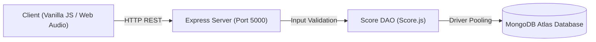

# OopsieFlip

> An interactive neon memory matching game with real-time score tracking, browser-native audio synthesis, and a persistent global leaderboard powered by MongoDB Atlas.

---

## Overview

**OopsieFlip** is a full-stack web application designed to deliver an engaging memory matching game experience. Players test their recall speed against a dynamic timer and move counter across a responsive 3D card grid. 

Completed game sessions are validated on the backend and stored in a persistent MongoDB database, updating a ranked global leaderboard in real time.

### Key Highlights
* **3D Card Flip Mechanics**: Perspective card flips built with CSS transforms, featuring neon accent glow on matches and animated shake feedback on mismatches.
* **Browser-Native Audio**: Real-time sound synthesis using the Web Audio API for flip blips, match chords, and victory chimes without external audio assets.
* **Challenge Modes**:
  - 🟢 **Easy (8 Cards / 4 Pairs)** — Quick and breezy warm-up!
  - 🔵 **Medium (16 Cards / 8 Pairs)** — The sweet spot for memory masters.
  - 🔴 **Hard (24 Cards / 12 Pairs)** — Intense high-speed concentration test.
* **Persistent Leaderboard**: Live rankings fetched via REST endpoints, featuring top-three podium highlights, difficulty filtering, pagination, and player rank identification.
* **Responsive Architecture**: Multi-page single-page application (SPA) layout optimized for mobile smartphones, tablets, and laptops.

---

## Technology Stack

| Layer | Technologies |
| :--- | :--- |
| **Frontend** | HTML5 (SPA Navigation), CSS3 (Cyberpunk Neon Theme & 3D Transforms), Vanilla JavaScript (ES6+) |
| **Backend** | Node.js, Express.js REST API |
| **Database** | MongoDB Atlas (Native MongoDB Node.js Driver with connection pooling & compound indexes) |
| **Audio** | Native Web Audio API |
| **Testing** | Automated unit and HTTP integration test runner (24 test assertions) |

---

## System Architecture



---

## Getting Started

### Prerequisites
* **Node.js (v18 or higher)**
* **npm (v9 or higher)**

### 1. Installation
Clone the repository and install project dependencies:
```bash
git clone https://github.com/jamunatg2006-sys/Code_Nova.git
cd Code_Nova
npm install
```

### 2. Environment Setup
Configure your `.env` file in the project root:
```env
PORT=5000
MONGODB_URI=your_mongodb_connection_string
DB_NAME=neon_memory_db
CLIENT_ORIGIN=*
```

### 3. Start the Server
Start the Express server (serves both API and frontend):
```bash
npm start
```
Open your browser and navigate to:
```
http://localhost:5000
```

### 4. Run Test Suite
Execute the automated validation and database integration tests:
```bash
npm test
```

---

## REST API Specification

### 1. Health Check
* **Endpoint**: `GET /api/health`
* **Response**: Server uptime, operational status, and MongoDB connectivity state.

### 2. Retrieve Leaderboard
* **Endpoint**: `GET /api/scores/leaderboard`
* **Query Parameters**:
  - `difficulty` *(optional)*: `Easy`, `Medium`, or `Hard`
  - `limit` *(optional)*: Results per page (default: `10`, max: `100`)
  - `page` *(optional)*: Page number for pagination (default: `1`)
* **Sorting Rule**: Ranked primarily by highest score (`score: -1`), with lower completion time (`timeTaken: 1`) as tie-breaker.

### 3. Submit Score
* **Endpoint**: `POST /api/scores`
* **Headers**: `Content-Type: application/json`
* **Payload**:
  ```json
  {
    "nickname": "CyberAce",
    "score": 1450,
    "moves": 16,
    "timeTaken": 32.5,
    "difficulty": "Medium"
  }
  ```
* **Validation**:
  - `nickname`: String, 2–20 characters, alphanumeric with spaces, underscores, and hyphens.
  - `score`: Non-negative integer.
  - `moves`: Positive integer ($\ge 1$).
  - `timeTaken`: Float or integer in seconds ($> 0$).
  - `difficulty`: One of `Easy`, `Medium`, or `Hard`.

---

## Project Structure

```
OopsieFlip/
├── backend/
│   ├── server.js               # Express application setup & static asset serving
│   ├── db.js                   # MongoDB Atlas connection manager with pooling
│   ├── Score.js                # Data access object, validation rules & compound indexes
│   ├── scoreController.js      # Controller logic for score submission and leaderboard
│   ├── scores.js               # Express router for /api/scores endpoints
│   └── tests/
│       └── test_validation.js # Automated test runner (24 unit & integration assertions)
│
├── frontend/
│   ├── index.html              # Semantic multi-page structure (Play, Leaderboard, Rules, About)
│   ├── style.css               # Neon visual design, 3D card flip styles & responsive queries
│   ├── game.js                 # Memory matching engine, timer, scoring, and Web Audio synth
│   └── leaderboard.js          # REST API communication, podium rendering & pagination
│
├── .env.example                # Template for environment configuration
├── package.json                # Project dependencies, scripts, and metadata
└── README.md                   # Project documentation
```

---

## Team & Contribution Breakdown

This project was developed by **Team Code Nova**:

### Jamuna T G — Project Lead & Full-Stack Integration
* Designed the complete backend architecture, Express routing, centralized error handling, and static client serving.
* Configured MongoDB Atlas connection pooling, data validation rules, and compound indexing.
* Implemented full-stack integration, dynamic client-server communication, and the browser-native Web Audio synthesizer.
* Designed the core scoring formula, automatic score submission flow, and personal operative banners.
* Authored the automated test runner (24 assertions) and managed GitHub workflow coordination.

### Niharika Patil — Frontend Design
* Structured the web page layout and semantic markup in `frontend/index.html`.
* Designed the core neon styling, visual color palette, and layout elements in `frontend/style.css`.

### Jaithra Sree Ram — Leaderboard logic
* Built leaderboard UI rendering, podium layout, and ranking table display in `frontend/leaderboard.js`.
* Implemented client-side API communication, difficulty filter switching, and score pagination.

### Diksha — Game Logic
* Implemented card generation, shuffle algorithm, and pair-matching mechanics in `frontend/game.js`.
* Developed move counter tracking and elapsed countdown/timer logic.

---

© 2026 **OopsieFlip** | Developed by Team Code Nova
