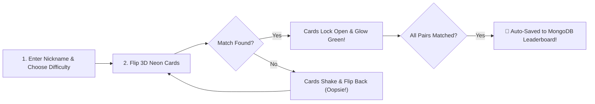

# 🧠 OopsieFlip 🎮

> **Flip it. Match it. Don't make an Oopsie!** ⚡  
> A fast-paced, brain-tickling cyberpunk memory game where every mismatch is a fun *oopsie*, and every winning streak lands you right at the top of the global leaderboard! 🏆

---

## 🌟 What is OopsieFlip?

**OopsieFlip** is an addictive, neon-inspired web game designed to test your memory, concentration, and speed. Whether you have 2 minutes to spare on your phone or want to battle your friends for the #1 spot on laptop, OopsieFlip delivers a smooth, thrilling arcade experience!

### ✨ Why It's Fun:
* **⚡ Neon-Powered 3D Cards**: Cards smoothly flip in 3D with glowing neon cyber aesthetics that pulse on matches and shake on mismatches.
* **🔊 Built-In Sound Synthesizer**: Uses the Web Audio API to create real-time sci-fi sound effects — crisp flip blips, cheerful match chords, and an epic victory fanfare with zero external audio downloads!
* **🎯 3 Exciting Challenge Modes**:
  - 🟢 **Easy (8 Cards / 4 Pairs)** — Quick and breezy warm-up!
  - 🔵 **Medium (16 Cards / 8 Pairs)** — The sweet spot for memory masters.
  - 🔴 **Hard (24 Cards / 12 Pairs)** — Intense high-speed concentration test!
* **🏆 Live Global Cyber Leaderboard**: Every finished game is automatically recorded in MongoDB Atlas. See your name on the Top 3 Champion Podium (🥇, 🥈, 🥉), filter by difficulty, and spot your own record highlighted with a `YOU` badge!
* **📱 100% Mobile & Laptop Friendly**: Responsive touch controls with zero mobile lag, clean single-page tabs, and high-contrast typography that is easy on the eyes.

---

## 🛠️ Technology Stack

| Layer | Technologies Used |
| :--- | :--- |
| **Frontend** | Vanilla HTML5 (Single-Page App Navigation), CSS3 (Cyberpunk Neon Theme & 3D Transforms), JavaScript (ES6+) |
| **Backend** | Node.js, Express.js REST API with automated routing & error handling |
| **Database** | MongoDB Atlas (Native `mongodb` Driver with connection pooling & compound indexing) |
| **Audio** | Native Web Audio API Synthesizer (Zero external mp3 files required) |
| **Testing** | Built-in Automated Unit & HTTP Integration Test Runner (24 test assertions) |

---

## 🎮 How the Game Works



1. **Enter your operative nickname** (e.g. `CyberNinja`, `jam`).
2. **Select your difficulty** and hit **▶ START MISSION**.
3. **Flip two cards at a time**. Match pairs as fast as you can with minimal moves to maximize your score!
4. **Instant Auto-Save**: When you match the last pair, your score is automatically calculated and registered on the live MongoDB leaderboard in real time!

---

## 🚀 Quick Start Guide

### 1. Prerequisites
Make sure **Node.js (v18+)** is installed.

### 2. Clone & Install Dependencies
```bash
git clone https://github.com/jamunatg2006-sys/Code_Nova.git
cd Code_Nova
npm install
```

### 3. Configure Environment Variables
Copy `.env.example` to `.env` and add your database configuration:
```env
PORT=5000
MONGODB_URI=your_mongodb_atlas_connection_string
DB_NAME=neon_memory_db
CLIENT_ORIGIN=*
```

### 4. Run OopsieFlip
```bash
npm start
```
Then open your browser to:  
👉 **`http://localhost:5000`**

### 5. Run Automated Tests
```bash
npm test
```
*(Runs 24 automated assertions validating payload boundaries, HTTP status codes, and live MongoDB persistence).*

---

## 📡 REST API Reference

| Method | Endpoint | Description |
| :--- | :--- | :--- |
| `GET` | `/api/health` | Server uptime & MongoDB connection health monitor |
| `GET` | `/api/scores/leaderboard` | Retrieve paginated high scores (supports `?difficulty=...&page=1&limit=10`) |
| `POST` | `/api/scores` | Auto-submits `{ nickname, score, moves, timeTaken, difficulty }` |

---

## 📁 Project Structure

```
OopsieFlip/
├── backend/
│   ├── server.js               # Express application & static frontend server
│   ├── db.js                   # MongoDB Atlas connection manager with pooling
│   ├── Score.js                # Score model, validation rules & compound indexes
│   ├── scoreController.js      # Leaderboard query & submission handlers
│   ├── scores.js               # Express API routing for /api/scores
│   └── tests/
│       └── test_validation.js # 24 automated unit & integration tests
│
├── frontend/
│   ├── index.html              # Multi-page layout (Play, Leaderboard, Rules, About)
│   ├── style.css               # Neon visual theme, 3D animations & mobile responsiveness
│   ├── game.js                 # Core memory card flip mechanics, audio engine & timer
│   └── leaderboard.js          # REST API communication, podium rendering & pagination
│
├── .env.example                # Template for environment configuration
├── package.json                # Project dependencies & scripts
└── README.md                   # Project documentation
```

---

## 👥 Team & Contribution Breakdown

This project was built collaboratively by **Team Code Nova**:

### 🌟 Jamuna T G — Project Lead & Full-Stack Architect *(Main Person)*
* **Architecture & Backend**: Designed and built the complete Express.js server, REST API endpoints, centralized error handling, and static client hosting.
* **Database & Security**: Configured MongoDB Atlas connection pooling, robust payload sanitization/validation, and database compound indexes.
* **Full-Stack Integration**: Integrated frontend with backend APIs, handled cross-origin requests, and engineered the real-time Web Audio synthesizer.
* **Game Logic & Refinements**: Designed the smart scoring formula, auto-submission flow, personal operative banners, and overall user journey.
* **DevOps & QA**: Built the 24-assertion automated test suite, GitHub repository coordination, and deployment configuration.

### 🎨 Niharika Patil — Frontend UI/UX
* Created the initial markup structure in `frontend/index.html`.
* Designed the core neon styling, color palette, and layout elements in `frontend/style.css`.

### 🏆 Jaithra Sree Ram — Leaderboard Integration
* Implemented leaderboard rendering, podium structure, and table display in `frontend/leaderboard.js`.
* Assisted with leaderboard difficulty filtering and API integration.

### 🃏 Diksha — Game Mechanics
* Contributed to the card flipping, deck shuffling, and pair-matching mechanics in `frontend/game.js`.
* Assisted with move counter tracking and elapsed timer logic.

---

© 2026 **OopsieFlip** | Developed by Team Code Nova
